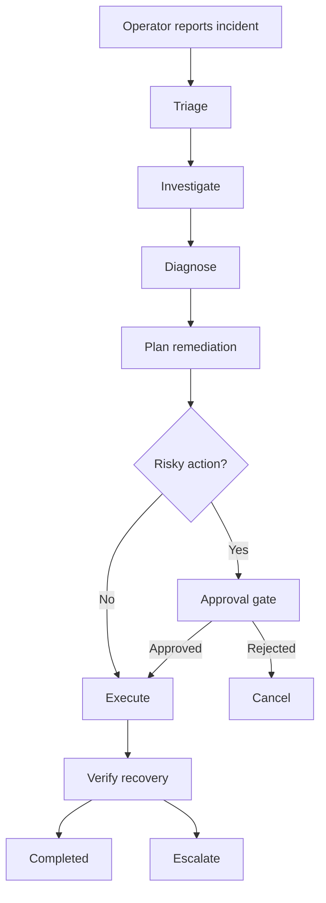
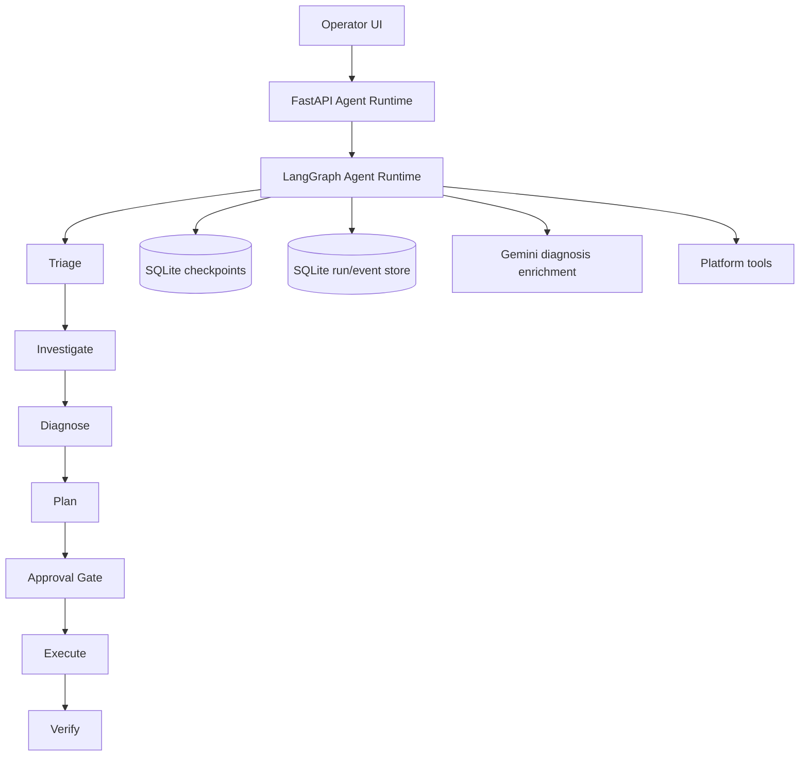
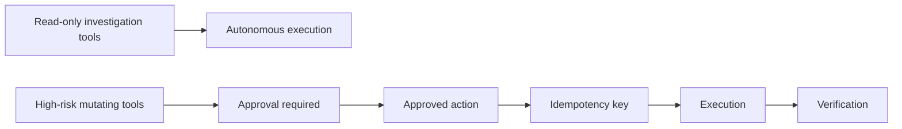
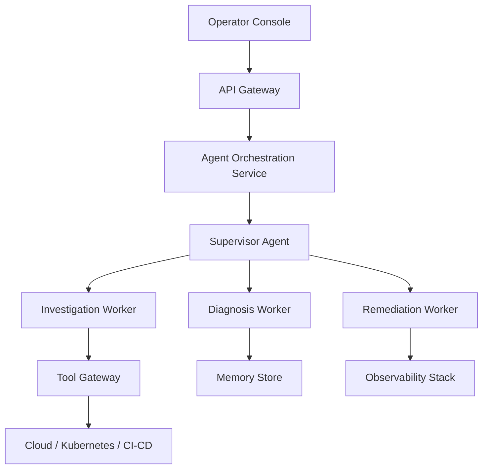

# Incident Triage & Safe Remediation Agent

A production-oriented AI agent that investigates platform incidents, explains its reasoning, proposes safe remediation, and waits for operator approval before executing any risky action.

Built with **Python, FastAPI, LangGraph, SQLite checkpointing, Gemini, React, and TypeScript**.


---

## What this project does

When an operator reports an incident, the agent:

1. Understands and classifies the incident.
2. Investigates using platform tools.
3. Collects evidence from logs, metrics, deployments, and runbooks.
4. Forms an evidence-based diagnosis.
5. Proposes a remediation plan.
6. Pauses for human approval before a risky action.
7. Executes only the approved action.
8. Verifies whether the service recovered.
9. Shows a complete decision trace to the operator.

The agent is autonomous during investigation, but it is **not allowed to silently change production state**.

---

## Live workflow



---

## Why this use case?

Platform teams need AI agents that reduce investigation time without creating operational risk.

| Concern | How it is handled |
|---|---|
| Autonomy | The agent plans, selects tools, investigates, and diagnoses |
| Safety | Rollback and restart require explicit operator approval |
| Trust | Every decision is backed by evidence and visible in the UI |
| Reliability | Workflow state is checkpointed and resumable |
| Observability | Every agent step, tool call, and approval is traced |
| Operator control | The operator can approve, reject, or request more investigation |

---

## What you will see in the UI

The operator console answers three questions:

1. What is the agent doing now?
2. Why did it make that decision?
3. What action needs my approval?

### 1. Start an incident

```text
┌──────────────────────────────────────────────────────┐
│ Report an incident                                   │
│                                                      │
│ Title: Checkout service 5xx spike                    │
│                                                      │
│ Description:                                         │
│ Checkout is returning 5xx errors after the latest    │
│ deployment. Database connections appear saturated.   │
│                                                      │
│ Service: checkout-service                            │
│ Environment: production                              │
│ Severity: high                                       │
│                                                      │
│ [Load sample incident]  [Start agent run]            │
└──────────────────────────────────────────────────────┘
```

Click **Load sample incident**, then click **Start agent run**.

### 2. Watch the agent investigate

```text
┌──────────────────────────────────────────────────────┐
│ Run: run_01H...       Status: Investigating          │
│                                                      │
│ 1. Triage                     Completed              │
│ 2. Investigate                Running                │
│ 3. Diagnose                   Pending                │
│ 4. Plan remediation           Pending                │
│ 5. Approval                   Pending                │
│ 6. Execute                    Pending                │
│ 7. Verify recovery            Pending                │
└──────────────────────────────────────────────────────┘
```

The agent calls read-only tools:

```text
query_metrics
search_logs
get_service_status
get_deployment_history
search_runbooks
```

### 3. See the diagnosis and evidence

```text
┌──────────────────────────────────────────────────────┐
│ Agent reasoning                                      │
│                                                      │
│ The 5xx increase began after deploy-184. Logs show   │
│ repeated database connection timeouts, and database  │
│ connections reached 100/100. The previous version    │
│ was stable, so rollback is the lowest-risk recovery  │
│ action.                                              │
│                                                      │
│ Confidence: 86%                                      │
└──────────────────────────────────────────────────────┘
```

Evidence cards show exactly what the agent used:

```text
EV-01 · query_metrics
Error rate: 18.4%
p99 latency: 2740 ms
Database connections: 100/100

EV-02 · search_logs
Database connection timeout detected
Correlation ID: req_8842

EV-03 · get_deployment_history
deploy-184 shipped v2.18.4
Changed database pool configuration
```

### 4. Approve the remediation

```text
┌──────────────────────────────────────────────────────┐
│ Approval required                                    │
│                                                      │
│ Proposed action: rollback_deployment                 │
│ Service: checkout-service                            │
│ From: v2.18.4                                        │
│ To: v2.18.3                                          │
│ Risk: HIGH                                           │
│                                                      │
│ Reason:                                              │
│ The 5xx increase began after deploy-184 and database │
│ connections reached their limit. Rolling back to the │
│ previously stable version is the lowest-risk action. │
│                                                      │
│ [Approve remediation]  [Reject]                      │
└──────────────────────────────────────────────────────┘
```

### 5. Verify recovery

```text
┌──────────────────────────────────────────────────────┐
│ Executing rollback...                                │
│ Rollback completed.                                  │
│                                                      │
│ Verifying recovery...                                │
│ Error rate: 0.3%                                     │
│ Service status: healthy                              │
│                                                      │
│ Result: Recovered                                    │
└──────────────────────────────────────────────────────┘
```

---

## Run it locally

### Prerequisites

Install:

- Python 3.11+
- Node.js 18+
- npm
- Git

Check versions:

```bash
python --version
node --version
npm --version
git --version
```

### 1. Clone the repository

```bash
git clone https://github.com/Zulfiqar78634/incident-triage-agent-langgraph.git
cd incident-triage-agent-langgraph
```

### 2. Start the backend

```bash
python -m venv .venv
source .venv/bin/activate

# Windows PowerShell:
# .venv\Scripts\activate

pip install -r requirements.txt
```

Create your local environment file:

```bash
cp .env.example .env
```

Open `.env` and add your Gemini API key:

```env
GEMINI_API_KEY=your_gemini_api_key
GEMINI_MODEL=gemini-2.0-flash
GEMINI_BASE_URL=https://generativelanguage.googleapis.com/v1beta/openai/
```

Start the backend:

```bash
uvicorn incident_agent.api.main:app --app-dir src --reload --port 8000
```

Backend URL:

```text
http://localhost:8000
```

### 3. Start the operator UI

Open a **new terminal**:

```bash
cd frontend
npm install
npm run dev
```

Open:

```text
http://localhost:5173
```

### 4. Run the demo

1. Click **Load sample incident**.
2. Click **Start agent run**.
3. Watch the agent investigate.
4. Review the evidence and diagnosis.
5. Approve the proposed rollback.
6. Watch execution and verification.
7. See the final `Completed` status.

---

## Test the API directly

### Start a run

```bash
curl -X POST http://localhost:8000/api/runs \
  -H "Content-Type: application/json" \
  -d '{
    "title": "Checkout service 5xx spike",
    "description": "Checkout is returning 5xx errors after the latest deployment.",
    "service": "checkout-service",
    "environment": "production",
    "severity": "high",
    "operator_id": "ops-alice"
  }'
```

Copy the `run_id` from the response.

### Check the run

```bash
curl http://localhost:8000/api/runs/{run_id}
```

### Approve the rollback

```bash
curl -X POST http://localhost:8000/api/runs/{run_id}/approve \
  -H "Content-Type: application/json" \
  -d '{
    "decision": "approved",
    "reason": "Deployment correlation and DB saturation support rollback.",
    "operator_id": "ops-alice"
  }'
```

### View the event trace

```bash
curl http://localhost:8000/api/runs/{run_id}/events
```

---

## Architecture



---

## Project structure

```text
incident-triage-agent-langgraph/
├── src/
│   └── incident_agent/
│       ├── core/                     # Settings, events, result types
│       ├── domain/                   # Incident, evidence, diagnosis models
│       ├── application/              # Ports, policies, tool registry, DI
│       ├── agent/                    # LangGraph state, graph, nodes, context
│       ├── infrastructure/           # Gemini, mock platform, SQLite
│       ├── api/                      # FastAPI routes and schemas
│       └── observability/            # Tracing and metrics
│
├── frontend/
│   └── src/
│       ├── components/               # Operator UI components
│       ├── hooks/                    # Run state and polling hooks
│       ├── api/                      # Backend client
│       └── types/                    # Shared TypeScript types
│
├── tests/
│   ├── unit/
│   └── integration/
│
├── docs/
│   ├── system_design.md
│   ├── architecture.md
│   ├── lld_agent_state.md
│   ├── lld_workflow.md
│   ├── lld_tools.md
│   ├── lld_context_memory.md
│   ├── lld_api.md
│   ├── lld_observability.md
│   ├── lld_security.md
│   └── lld_scaling.md
│
├── ai_usage/
│   └── AI_INTERACTION_LOG.md
│
├── README.md
├── pyproject.toml
├── requirements.txt
├── Makefile
└── .env.example
```

---

## Engineering principles

### SOLID

| Principle | Implementation |
|---|---|
| Single Responsibility | Each LangGraph node has one clear job |
| Open/Closed | New tools or LLM providers can be added without changing the workflow |
| Liskov Substitution | Gemini and no-key LLM clients implement the same interface |
| Interface Segregation | Separate ports for platform tools, LLM, and persistence |
| Dependency Inversion | Agent and API depend on interfaces, not concrete infrastructure |

### Design patterns

- **Strategy:** deterministic and Gemini diagnosis strategies
- **Registry:** tools registered with metadata, risk, and approval policy
- **Repository:** run and event persistence behind an interface
- **Dependency Injection:** central application container
- **Policy:** approval and retry rules separated from workflow logic
- **Facade:** tool executor hides validation, retries, and audit concerns
- **Observer:** structured event stream for observability
- **State Machine:** LangGraph models the incident workflow explicitly

---

## Context engineering

The agent does not put everything into the model context.

```text
Context budget
├── System policy: always retained
├── Incident objective: always retained
├── Current diagnosis and plan: always retained
├── Evidence: selected by relevance and budget
├── Tool output: summarized or truncated
├── Conversation: recent turns retained
└── Long-term memory: relevant facts only
```

---

## Safety model



The approval gate is implemented as a LangGraph interrupt, not a prompt instruction.

---

## Observability

Every run records:

```text
run_started
node_entered
node_completed
tool_call_started
tool_call_completed
tool_call_failed
tool_call_retried
approval_requested
approval_granted
approval_rejected
action_executed
verification_completed
run_completed
run_failed
escalated
```

---

## Tests

Run all tests:

```bash
pytest -q
```

Tests cover:

- Incident classification.
- Tool execution.
- Evidence-based diagnosis.
- Approval gate behavior.
- Approval resume.
- Rejection safety.
- Context budgeting.
- Restart and resume behavior.

---

## Enterprise target architecture

The submitted implementation is intentionally focused on a reliable, locally runnable agent runtime.

For enterprise scale, the same design would evolve into:



These enterprise components are documented as the production roadmap, not claimed as part of the local assessment implementation.

---

## What I would build next

- Replace mock tools with real cloud, Kubernetes, and observability APIs.
- Add Postgres-backed durable execution.
- Add role-based access control and tool authorization.
- Add LangSmith or Langfuse tracing.
- Add a golden-set evaluation suite and CI quality gates.
- Add multi-agent supervisor/worker execution.
- Add memory lifecycle policies, redaction, and operator-editable memory.

---

## AI usage

AI was used to accelerate scaffolding, implementation, documentation, and test design. Architectural decisions, safety boundaries, and production trade-offs were reviewed as part of the implementation.

See `ai_usage/AI_INTERACTION_LOG.md`.
