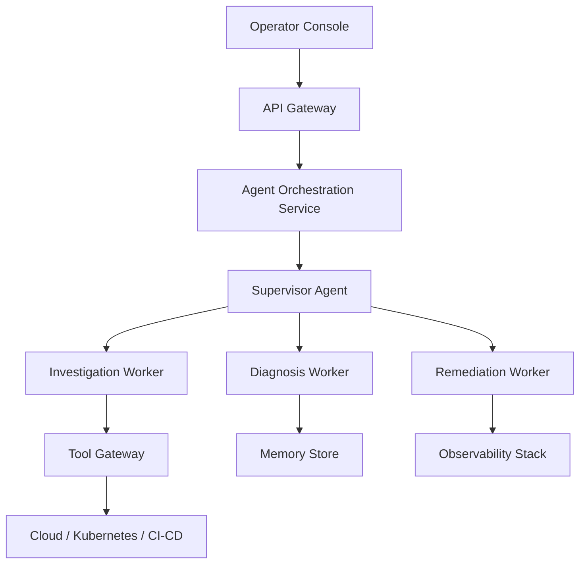

# LLD — Scaling and Enterprise Roadmap

## Current implementation

```text
Single FastAPI service
Single LangGraph workflow
SQLite checkpointing
Mock platform tools
Local operator UI
```

## Enterprise target



## Scaling decisions

| Concern | Current | Enterprise target |
|---|---|---|
| Persistence | SQLite | Postgres |
| Workflow execution | Single process | Durable workers and queues |
| Tool execution | In-process mock tools | Sandboxed tool gateway |
| Retrieval | Simple runbook search | Vector database with reranking |
| Observability | SQLite event stream | OpenTelemetry, LangSmith, or Langfuse |
| Security | Approval gate | Auth, RBAC, policy engine, audit export |
| Deployment | Local process | Kubernetes with horizontal scaling |

## Rollout plan

1. Replace mock tools with real read-only integrations.
2. Move checkpointing to Postgres.
3. Add authentication, RBAC, and audit logging.
4. Add tool gateway with sandboxing and policy enforcement.
5. Add vector retrieval and evaluation harness.
6. Add supervisor/worker execution for parallel investigation.
7. Deploy to Kubernetes with observability and alerting.
