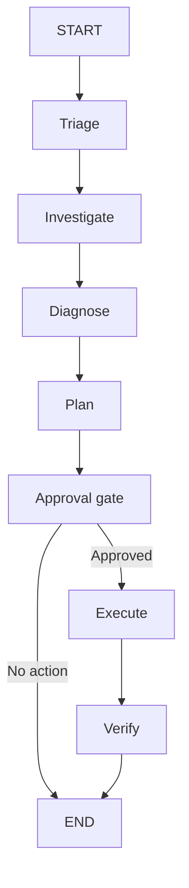

# LLD — LangGraph Workflow

## Workflow



## Nodes

| Node | Input | Responsibility | Output |
|---|---|---|---|
| `triage` | Incident | Classify service, environment, severity | Classification |
| `investigate` | Classification | Call read-only tools and collect evidence | Evidence, tool calls |
| `diagnose` | Evidence | Select root cause using strategies | Diagnosis |
| `plan` | Diagnosis | Select remediation action | Plan, pending action |
| `approval_gate` | Plan | Interrupt for risky action | Approval decision |
| `execute` | Approved plan | Execute action with retry | Execution result |
| `verify` | Execution result | Check recovery | Verification result |

## Routing

```python
def _route_after_approval(state):
    if state["plan"]["action"] == "none":
        return "end"
    return "execute"
```

## Failure paths

| Failure | Behavior |
|---|---|
| Tool validation failure | Tool returns structured error |
| Transient tool failure | One bounded retry |
| Repeated failure | Run marked failed |
| Insufficient evidence | No action; escalation path |
| Operator rejection | Run cancelled; no mutation |
| Verification failure | Run escalated |
