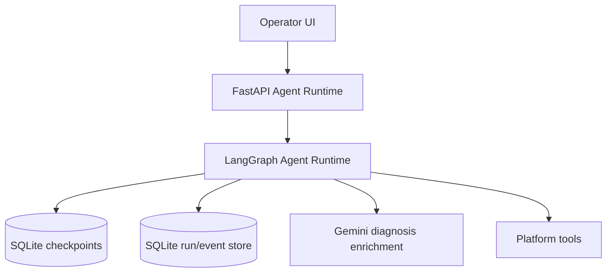
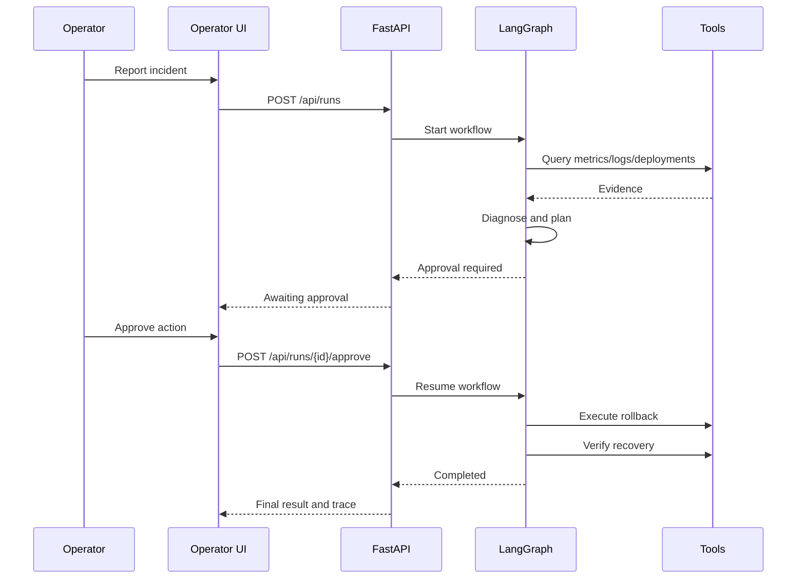
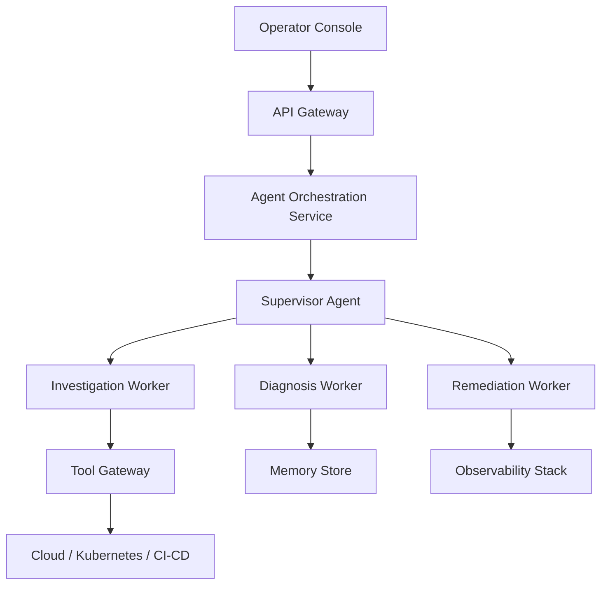

# System Design — HLD

## Problem

Platform teams need an AI agent that can reduce incident investigation time without taking unsafe autonomous actions in production.

## Users

- **Operator:** reports incidents, reviews evidence, approves or rejects remediation.
- **Agent runtime:** investigates incidents and proposes actions.
- **Platform tools:** provide logs, metrics, service health, deployments, and runbooks.

## Current architecture

## Component responsibilities

| Component | Responsibility |
|---|---|
| Operator UI | Incident intake, live workflow, evidence, approval, trace |
| FastAPI | Run lifecycle, state, events, approvals, tool catalog |
| LangGraph | Explicit agent workflow, state, interrupts, checkpoints |
| Tool registry | Tool metadata, validation, execution, risk classification |
| Gemini client | Optional evidence-based diagnosis enrichment |
| SQLite store | Durable checkpoints, run metadata, event stream |
| Mock platform | Logs, metrics, service health, deployments, rollback |

## Data flow

## Agent autonomy boundary

The agent can autonomously:

- Classify incidents.
- Select and call read-only tools.
- Collect evidence.
- Form hypotheses.
- Propose remediation.

The agent cannot autonomously:

- Roll back a deployment.
- Restart a service.
- Change production configuration.

Those actions require explicit operator approval.

## Enterprise target architecture

This is the production scale-out roadmap, not the implemented local assessment scope.

### Enterprise components

| Component | Purpose |
|---|---|
| API gateway | Authentication, RBAC, rate limiting, audit |
| Orchestration service | Durable multi-agent workflow execution |
| Supervisor/worker agents | Parallel investigation and specialized execution |
| Tool gateway | Sandboxing, policy enforcement, audit logging |
| Postgres | Production-grade checkpoint and run persistence |
| Redis | Session cache and short-lived working state |
| Vector database | Runbook and incident-history retrieval |
| Observability stack | Traces, metrics, cost, latency, evaluations |
| Kubernetes | Deployment, scaling, and resilience |

## Trade-offs

| Decision | Benefit | Trade-off |
|---|---|---|
| SQLite locally | Simple, reproducible demo | Not multi-instance production grade |
| Mock tools | No cloud credentials required | Requires replacement for real operations |
| Single LangGraph workflow | Clear, testable control flow | Less parallelism than multi-agent design |
| Gemini enrichment | Better natural-language diagnosis | LLM output is advisory, not authoritative |
| Approval gate | Safe production mutations | Adds operator latency |
